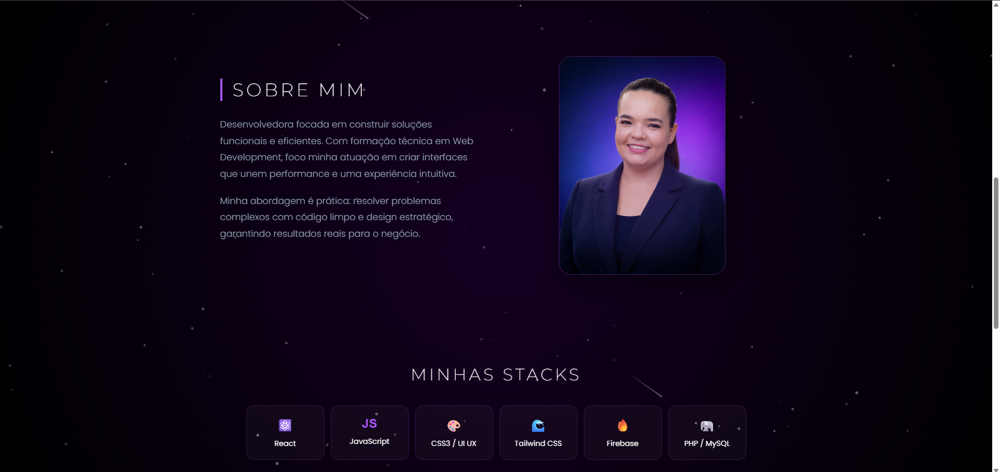
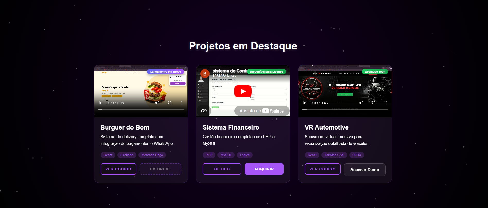
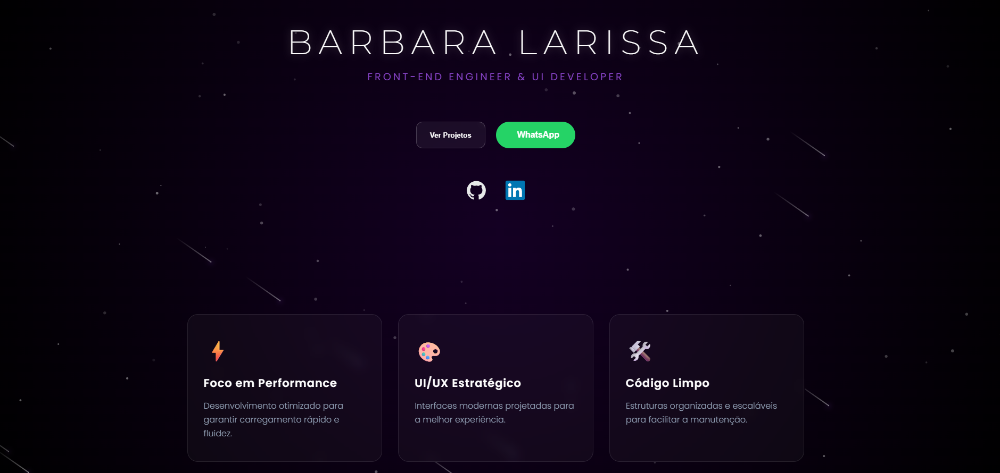

# Barbara Larissa | Portfólio Digital

Este é o meu portfólio profissional, desenvolvido para demonstrar minhas habilidades em **Front-end Engineering** e **UI Development**. O projeto foca em interfaces modernas, alta performance e interatividade.

## 🚀 Sobre o Projeto
O portfólio foi construído utilizando **React** e **Vite**, garantindo uma navegação fluida e rápida. A estrutura prioriza o destaque dos meus projetos técnicos, com design responsivo e foco em experiência do usuário (UX).

## 🛠️ Tecnologias
* **Linguagem:** JavaScript (ES6+)
* **Interface:** React.js
* **Estilização:** Tailwind CSS & CSS Moderno
* **Performance:** Vite (Build otimizado)
* **Interatividade:** Particles.js e animações personalizadas

## 📸 Prévia do Projeto

| Visão Geral | Detalhes | VR Automotive |
| :---: | :---: | :---: |
|  |  |  |

## 📁 Estrutura de Projetos
A seção de projetos destaca soluções desenvolvidas para cenários reais:

* **Burguer do Bom:** Sistema de delivery focado em UX e agilidade.
* **Sistema Financeiro:** Aplicação voltada para gestão e controle de dados.
* **VR Automotive:** Showroom virtual imersivo desenvolvido com foco em tecnologias de visualização 3D.


1. **Clone o repositório:**
   ```bash
   git clone [https://github.com/Barbara-larissa/portfolior.git](https://github.com/Barbara-larissa/portfolior.git)